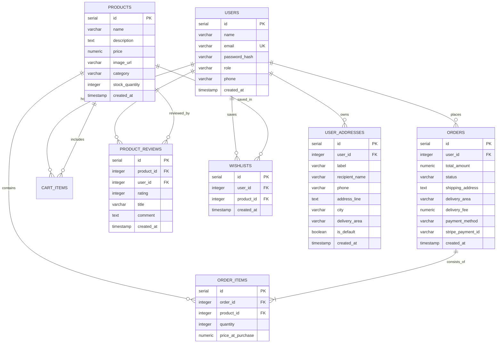

# ? PlugNPlay � Next-Gen Electronics & Peripherals E-Commerce Platform

[](https://nodejs.org/)
[](https://expressjs.com/)
[](https://www.postgresql.org/)
[](https://developer.mozilla.org/)
[](https://www.w3.org/TR/css/)

> **PlugNPlay** is a high-performance, full-stack electronics and computer peripherals e-commerce platform engineered specifically for competitive setups, audiophiles, and everyday productivity across Bangladesh.

---

## ?? Key Highlights & Feature Matrix

### 1. ??? Futuristic Hardware Storefront
* **Curated Peripherals:** Mechanical Keyboards (75% gasket-mount), Ultralight Wireless Mice (26K DPI), Hybrid ANC Studio Headsets, Low-latency Earbuds, Asymmetrical ScreenBar Monitor Lights, and Extended XL Desk Mats.
* **Dynamic Aesthetics:** Dark-mode cyber-inspired glassmorphism with glowing neon accents, 3D interactive card tilt on pointer hover, and ambient radial spotlights.
* **Advanced Multi-Criteria Filtering:**
  * Category chips with real-time product count badges.
  * Price-range quick pills (Under ?3k, ?3k�?6k, Above ?6k).
  * "In Stock Only" toggle with pulsating status indicator.
  * Multi-criteria sorting (Newest drops, Price Low-to-High, Price High-to-Low, A-to-Z).

### 2. ?? Instant Search & Command Palette (`Ctrl + K`)
* **Global Shortcut:** Press **`Ctrl + K`** (or **`/`**) anywhere across the store to summon the floating Command Palette.
* **Instant Keyword Highlight:** Search term characters are dynamically highlighted with neon `<mark>` tags.
* **In-Shop Autocomplete Popover:** Typing in the storefront search bar activates a dropdown with mini art, live BDT price, category badges, and star ratings.
* **Keyboard Accessible:** Full arrow key navigation (`?`, `?`), `Enter` to open, and `Esc` to dismiss.

### 3. ? Customer Reviews & Star Ratings System
* **Verified Buyer Badging:** Dynamically checks order records to reward verified customers with an official green badge.
* **Interactive Star Rating Submission:** 1-to-5 star picker with review headline and detailed comments.
* **Distribution Bar Graph:** Real-time percentage bars for 5?, 4?, 3?, 2?, and 1? ratings alongside overall store average.

### 4. ?? Persistent Wishlist System
* **Quick Heart Toggles:** Save dream gear directly from product cards or product detail pages with subtle pulse animations.
* **Dedicated Wishlist View (`/wishlist.html`):** Manage saved hardware with 1-click **"Move to Cart"** and **"Move All to Cart"** bulk actions.
* **Live Navbar Counter:** Dynamic badge counter updates in real time.

### 5. ?? Bangladesh-Tailored Cart & Checkout
* **Automated Delivery Fee Calculation:**
  * Inside Dhaka Express Delivery: **?60**
  * Outside Dhaka Courier Delivery: **?120**
* **Delivery Zone Selector:** Interactive radio cards in both Cart and Checkout pages � persisted via `localStorage`.
* **Flexible Payment Options:** Cash on Delivery (COD) and Online Card (Stripe) payments.
* **Accurate Shipping Total:** `total_amount` stored in DB = `items subtotal + delivery_fee`. Order cards always display the shipping breakdown.
* **Cart Badge Animations:** Interactive quantity stepper with visual cart badge bump animations.

### 6. ?? Order Tracking & Printable Tax Invoices
* **Live Lifecycle Pipeline:** Track orders across `pending`, `paid`, `shipped`, `delivered`, and `cancelled` states.
* **Itemized Drawer:** Expandable order cards showing purchase price, quantity, and product thumbnails.
* **Shipping Total Always Visible:** Every order card shows "Incl. ?XX shipping" using fallback area-based calculation for older records.
* **Official Printable Tax Invoice:**
  * Clean, high-contrast `@media print` layout ready for paper printing or PDF export.
  * Includes store registration, customer shipping address, invoice number (`#INV-00000X`), itemized breakdown, and official 1-Year hardware replacement guarantee certificate with digital barcode.
  * Grand Total pulled directly from `order.total_amount` (DB ground truth) to avoid double-counting.

### 7. ?? Role-Based Admin Control Dashboard (`/admin.html`)

The Admin Dashboard is a fully-featured, single-page control panel accessible only to users with `role = 'admin'`. It is split into **3 tabs**:

#### ?? Tab 1 � Products Catalog Management

| Feature | Details |
|---|---|
| **Product Table** | Full catalog with thumbnail, name, category tag, price, stock badge |
| **Add Product** | Modal form: name, category, price (?), stock quantity, image URL, description |
| **Edit Product** | Pre-populated modal � same form, PUT to `/api/products/:id` |
| **Delete Product** | Confirmation modal before permanent removal |
| **Category Filter** | Dropdown auto-populated from live product categories |
| **Search Filter** | Real-time client-side search across name and category |
| **Stock Badge Colors** | ?? In Stock / ?? Low Stock (= 5 units) / ?? Out of Stock |
| **Inline +10 Restock** | One-click `+10` button directly in the table for low-stock items |

#### ?? Tab 2 � Customer Orders Management

| Feature | Details |
|---|---|
| **All Orders View** | Shows every customer order with name, email, shipping address |
| **Order Items Preview** | Inline thumbnail + name + quantity + subtotal for each order item |
| **Status Dropdown** | Live `<select>` per order: Pending ? Paid ? Shipped ? Delivered ? Cancelled |
| **1-Click Status Update** | `PUT /api/orders/admin/:id/status` updates DB instantly |
| **Search** | Filter by order ID, customer name, email, or shipping address |
| **Status Filter** | Dropdown to show only specific status states |
| **Payment Badge** | ?? Cash on Delivery vs ?? Paid by Card (Stripe) |

#### ?? Tab 3 � Analytics & Insights

| Metric | Description |
|---|---|
| **Average Order Value (AOV)** | Mean spend per completed checkout |
| **Fulfillment Rate** | `delivered / total_valid_orders � 100%` |
| **COD Order Volume** | Total revenue + count from Cash on Delivery orders |
| **Card / Stripe Volume** | Total revenue + count from prepaid card orders |
| **Delivery Area Breakdown** | Progress bars: Inside Dhaka vs Outside Dhaka split |
| **Payment Methods Split** | Progress bars: COD % vs Card % |
| **Top Selling Products** | Leaderboard by units sold � ranked #1�#5 with revenue |
| **Category Performance** | Revenue + units sold per category with animated bar |

#### ? Quick Restock Hub (Modal)
* Click **Quick Restock Hub** button to open a dedicated modal showing all low-stock products.
* One-click `+5`, `+10`, `+25` buttons to instantly replenish inventory via `PATCH /api/products/:id/stock`.
* Live-updates the table and metrics without page refresh.

#### ?? Admin Access Control
* JWT token + `role === 'admin'` check runs client-side on page load � unauthorized users are immediately redirected to `/login.html`.
* All admin API endpoints (`/orders/admin/*`, `POST/PUT/DELETE /products`) require `verifyToken + isAdmin` middleware on the backend.

---

## ?? Project Architecture

```
ecommerce-store/
+-- backend/
�   +-- config/
�   �   +-- db.js                 # PostgreSQL connection pool with error handling
�   �   +-- stripe.js             # Stripe SDK configuration
�   +-- controllers/
�   �   +-- authController.js     # User registration, JWT login, profile
�   �   +-- cartController.js     # User cart management
�   �   +-- checkoutController.js # Checkout, delivery fee calculation, Stripe
�   �   +-- orderController.js    # Order listing, details, admin status updates, analytics
�   �   +-- productController.js  # Product catalog, stock updates, fast search
�   �   +-- reviewController.js   # Rating summaries, reviews feed, verified buyer check
�   �   +-- wishlistController.js # Wishlist toggling, listing, item removals
�   +-- middleware/
�   �   +-- authMiddleware.js     # verifyToken, isAdmin, optionalAuth
�   +-- models/
�   �   +-- orderModel.js         # Orders & order_items queries
�   �   +-- productModel.js       # Products queries & ILIKE search engine
�   �   +-- reviewModel.js        # Reviews & verified buyer queries
�   �   +-- wishlistModel.js      # Wishlist CRUD queries
�   +-- routes/
�   �   +-- authRoutes.js         # /api/auth/*
�   �   +-- cartRoutes.js         # /api/cart/*
�   �   +-- checkoutRoutes.js     # /api/checkout
�   �   +-- orderRoutes.js        # /api/orders/* (user + admin)
�   �   +-- productRoutes.js      # /api/products/*
�   �   +-- reviewRoutes.js       # /api/reviews/*
�   �   +-- userRoutes.js         # /api/user/* (profile, addresses)
�   �   +-- wishlistRoutes.js     # /api/wishlist/*
�   +-- migrate.js                # Database schema migrations & demo seeds
�   +-- server.js                 # Express application entrypoint
�
+-- frontend/public/
    +-- css/
    �   +-- admin.css             # Admin dashboard � tables, modals, metrics cards
    �   +-- auth.css              # Login & registration styling
    �   +-- cart.css              # Cart drawer & items layout
    �   +-- checkout.css          # Delivery area cards & payment selection
    �   +-- orders.css            # Order cards & printable invoice @media print
    �   +-- product.css           # Hardware detail view & reviews hub
    �   +-- profile.css           # Account information & shipping address book
    �   +-- search.css            # Command palette & autocomplete popover
    �   +-- style.css             # Core design tokens, hero, grid, nav
    �   +-- wishlist.css          # Saved hardware grid styling
    +-- js/
    �   +-- admin.js              # Admin CRUD, order management, analytics rendering
    �   +-- api.js                # apiRequest() helper with JWT token handling
    �   +-- auth.js               # Login & sign-up form logic
    �   +-- cart.js               # Cart page stepper, delivery fee, checkout link
    �   +-- checkout.js           # Fee calculation, summary sidebar, form submission
    �   +-- home.js               # Storefront, autocomplete popover, 3D tilt
    �   +-- orders.js             # Order history, invoice print trigger, shipping total
    �   +-- product.js            # Details view, review form, star picker
    �   +-- profile.js            # Address saving & account stats
    �   +-- ui.js                 # Global navigation, Command Palette (Ctrl+K), theme
    �   +-- wishlist.js           # Wishlist page & move-to-cart actions
    +-- images/                   # High-res hardware photos & graphics
    +-- admin.html                # Admin Dashboard portal (Products + Orders + Analytics)
    +-- cart.html                 # Shopping Cart page
    +-- checkout.html             # Multi-step Checkout page
    +-- index.html                # Main Hardware Storefront
    +-- login.html                # Sign In page
    +-- orders.html               # Orders & Printable Invoices page
    +-- product.html              # Product Details & Reviews page
    +-- profile.html              # Customer Profile & Address Book
    +-- register.html             # Customer Registration page
    +-- wishlist.html             # Saved Hardware Wishlist page
```

---

## ??? Database Schema

The database runs on PostgreSQL with the following relational tables:



---

## ??? Quickstart & Local Setup Guide

### 1. Prerequisites
* [Node.js](https://nodejs.org/) (version 18 or newer)
* [PostgreSQL](https://www.postgresql.org/) (running locally or cloud instance)

### 2. Clone Repository & Install Dependencies
```bash
git clone https://github.com/chowdhurybahalulhossain/PlugNPlay-Ecommerce-Store.git
cd PlugNPlay-Ecommerce-Store
npm install
```

### 3. Environment Configuration
Create or edit `backend/.env` with your PostgreSQL and application credentials:

```env
PORT=5000
DB_HOST=localhost
DB_USER=postgres
DB_PASSWORD=yourpassword
DB_NAME=ecommerce_db
DB_PORT=5432
JWT_SECRET=plugnplay_super_secret_jwt_key_2026
STRIPE_SECRET_KEY=sk_test_your_stripe_key
```

### 4. Database Setup & Migration
Run the automated migration script to create all relational tables and seed sample gear and reviews:
```bash
npm run migrate
# or
node backend/migrate.js
```

### 5. Launch the Application
Start the Node.js development server:
```bash
npm start
# or
node backend/server.js
```

Open your browser and navigate to:
?? **`http://localhost:5000`**

### 6. Create an Admin Account
Register a new user, then manually set `role = 'admin'` in PostgreSQL:
```sql
UPDATE users SET role = 'admin' WHERE email = 'your@email.com';
```
Then navigate to **`http://localhost:5000/admin.html`**.

---

## ?? Core API Reference

### ?? Authentication
| Endpoint | Method | Auth | Description |
| :--- | :---: | :---: | :--- |
| `/api/auth/register` | `POST` | Public | Register new user account |
| `/api/auth/login` | `POST` | Public | Login, returns JWT token |
| `/api/auth/profile` | `GET` | User | Get authenticated user profile |

### ??? Products
| Endpoint | Method | Auth | Description |
| :--- | :---: | :---: | :--- |
| `/api/products` | `GET` | Public | List all products (supports `?q=` query) |
| `/api/products/search` | `GET` | Public | Instant autocomplete search with star ratings |
| `/api/products/:id` | `GET` | Public | Get single product specification details |
| `/api/products` | `POST` | Admin | Create new peripheral product |
| `/api/products/:id` | `PUT` | Admin | Update product details |
| `/api/products/:id/stock` | `PATCH` | Admin | Quick stock increment (`delta`) or full override |
| `/api/products/:id` | `DELETE` | Admin | Permanently remove product |

### ? Reviews
| Endpoint | Method | Auth | Description |
| :--- | :---: | :---: | :--- |
| `/api/reviews/product/:id` | `GET` | Optional | Get reviews, 5-star breakdown & verified buyer check |
| `/api/reviews/product/:id` | `POST` | User | Submit or update product rating review |

### ?? Wishlist
| Endpoint | Method | Auth | Description |
| :--- | :---: | :---: | :--- |
| `/api/wishlist` | `GET` | User | Get user's saved wishlist items |
| `/api/wishlist/toggle/:id` | `POST` | User | 1-click add/remove wishlist item |
| `/api/wishlist/:id` | `DELETE` | User | Remove specific item from wishlist |

### ?? Cart & Checkout
| Endpoint | Method | Auth | Description |
| :--- | :---: | :---: | :--- |
| `/api/cart` | `GET` | User | Fetch active cart items |
| `/api/cart` | `POST` | User | Add item to cart |
| `/api/cart/:id` | `PUT` | User | Update item quantity |
| `/api/cart/:id` | `DELETE` | User | Remove item from cart |
| `/api/checkout` | `POST` | User | Process order � calculates BD delivery fee, runs Stripe if card |

### ?? Orders
| Endpoint | Method | Auth | Description |
| :--- | :---: | :---: | :--- |
| `/api/orders` | `GET` | User | List customer's own order history |
| `/api/orders/:id` | `GET` | User | Order + items detail (for invoice generation) |
| `/api/orders/admin/all` | `GET` | Admin | All customer orders with user info |
| `/api/orders/admin/analytics` | `GET` | Admin | Revenue, profit, expense, inventory valuation, recent activity |
| `/api/orders/admin/timeseries` | `GET` | Admin | Daily, Monthly, Yearly revenue & profit trend datasets |
| `/api/orders/admin/:id/status` | `PUT` | Admin | Update order status lifecycle |

### ?? User Profile
| Endpoint | Method | Auth | Description |
| :--- | :---: | :---: | :--- |
| `/api/user/profile` | `GET` | User | Get profile & stats |
| `/api/user/profile` | `PUT` | User | Update name, phone |
| `/api/user/addresses` | `GET` | User | Get saved delivery addresses |
| `/api/user/addresses` | `POST` | User | Save new address (label, recipient, phone, area) |
| `/api/user/addresses/:id` | `DELETE` | User | Remove saved address |

---

## ?? Keyboard Shortcuts

| Shortcut | Action |
| :---: | :--- |
| **`Ctrl + K`** (or **`Cmd + K`**) | Open global Instant Search & Command Palette |
| **`/`** | Quick open search from anywhere on the storefront |
| **`?` / `?`** | Navigate between search suggestions |
| **`Enter`** | Open selected gear product |
| **`Esc`** | Dismiss command palette or modals |

---

## ?? Bug Fixes Log

| Issue | Root Cause | Fix Applied |
|---|---|---|
| Shipping total not showing in order card | delivery_fee falsy check failed for string values | Always render shipping row with Number() coercion and area-based fallback |
| Invoice grand total mismatch | Invoice recalculated subtotal + fee but DB total_amount already included fee | Invoice now uses order.total_amount as ground truth |
| Invoice items product_name undefined | orders/:id endpoint returned name field only | Added p.name AS product_name alias in SQL query |

---

## ?? License & Attribution

Distributed under the **MIT License**. Engineered for high-performance setups and daily computing productivity across Bangladesh. ????
